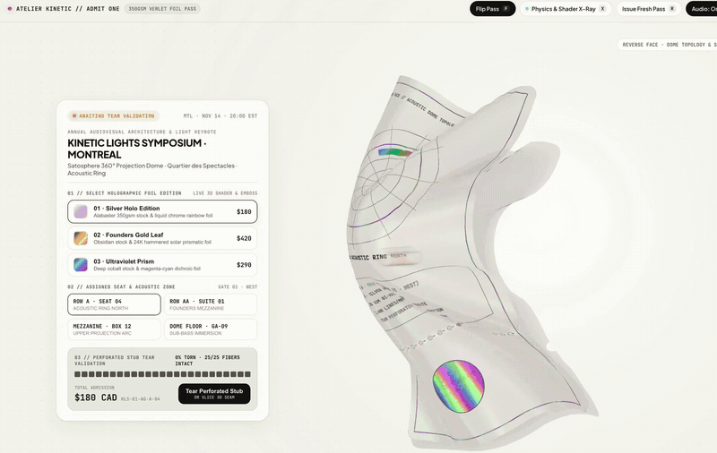

# Ticket Tear

A concert ticket checkout where the ticket is a real 3D object. Bend it, flip it over and tear off the stub, one paper fiber at a time.

[**Play with it live**](https://sam1983aing.github.io/ticket-tear/) · [**The prompt**](PROMPT.md) · [**Source**](https://github.com/Sam1983Aing/ticket-tear)



Built on the first try with Gemini 4 Argon, set to High, in [Google Antigravity](https://antigravity.google/). The prompt to build your own is in [PROMPT.md](PROMPT.md).

## Try it

Best on a laptop, with the sound on. On a phone, scroll down to the ticket and tap Tear Perforated Stub.

- Move the mouse over the ticket and it tilts toward you, so the foil catches the light.
- Drag the ticket to bend it.
- Drag across the dotted perforation line, or pull the stub down, to tear it off.
- Pick a foil: Silver Holo, Founders Gold Leaf or Ultraviolet Prism.
- Double-click or press `F` to flip the ticket over. `X` shows every spring in the paper, `R` gives you a fresh ticket and `T` switches to the dark theme.

## How it's made

Vite, TypeScript, Three.js, custom GLSL shaders and the Web Audio API. No images, no 3D models and no audio files. Every texture is drawn in code and every sound is synthesized live.

**1. Paper that bends like card, not cloth.** The ticket is a grid of 900 points (25 columns by 36 rows) held together by springs and solved 10 times a frame with Verlet integration. There are four kinds of spring: structural along the grid (stiffness 0.94), shear across the diagonals (0.82), and bending springs that skip 2 and 4 points (0.76 and 0.56). Cloth sims usually stop at neighbours. The long bending springs are what keep the card from creasing and make it curve in smooth, stiff arcs. See `src/verletPaperEngine.ts`.

**2. The split seam.** At 72% down the ticket, the body (rows 0 to 24) and the stub (rows 25 to 35) are two separate meshes that share no triangles. Only 25 breakable springs join them, one per column. When you drag across the seam they snap one at a time. Each snap switches off the springs crossing the seam in that column and gives the torn edge a small curl, so a real V-shaped gap opens while the rest still holds. When all 25 are gone, the stub falls with a bit of flutter and tumble.

**3. Foil that follows the bend.** After every physics step the surface normals are recalculated across the deformed mesh and fed into a custom shader (`src/holographicShader.ts`). It adds a thin-film rainbow from a cosine palette (`a + b * cos(2π(c*t + d))`), Voronoi glitter flakes that flash when they line up with the light, letterpress emboss from a height map, and the punched perforation holes, which are cut out with `discard`. The front and back textures are drawn on a 1024 by 1740 canvas in `src/ticketTextureGenerator.ts`. Red holds the foil mask, green the emboss height and blue a phase offset for the rainbow.

**4. A rip sound made in code.** Each fiber that snaps plays a short band-passed noise burst. The pitch climbs from about 1.35 kHz to 2.8 kHz across the 25 fibers, so a fast swipe sounds like a zip and a slow drag lets you hear each one go. A chord plays when the stub comes off. See `src/soundEngine.ts`.

## Run it locally

```bash
npm install
npm run dev
```

Then open http://localhost:5203/.

`npm run build` writes the site to `docs/`, which is what GitHub Pages serves.

## Structure

```text
index.html                     the checkout layout
src/main.ts                    scene, lights, input, the checkout UI and the keys
src/verletPaperEngine.ts       the paper physics, the seam and the tear
src/holographicShader.ts       foil, glitter, emboss and the punched holes
src/ticketTextureGenerator.ts  front and back of the ticket, drawn on canvas
src/soundEngine.ts             the fiber snaps and the chord
src/style.css                  layout and both themes
docs/                          the built site for GitHub Pages
media/                         the preview in this README
PROMPT.md                      the prompt
```

## Notes

- Needs a network connection for the Google Fonts (Instrument Serif, JetBrains Mono and Plus Jakarta Sans).
- Three.js is MIT licensed.
- Kinetic Lights Symposium, Atelier Kinetic and the prices are made up. This is a design study, with no link to any event, venue or ticketing company. The QR code and barcode are decoration.

Made by Samnang Aing. I share builds like this as I go on [X](https://x.com/SammmAing) and [Threads](https://www.threads.com/@samnang.aing).
